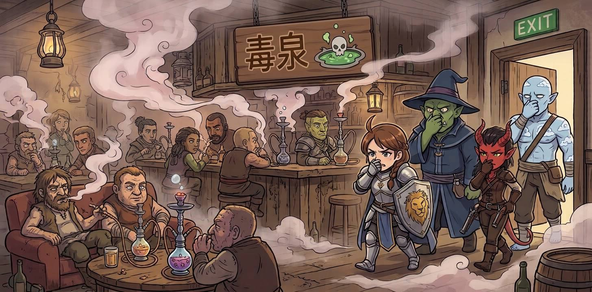

# Mission: R0046DW  

Mission R0046DW-黑曜之秤  
DM：Deathwalker  
Level：3-4  
人數：4-7  
日期：2026年11月1日 (星期日)  
時間：14:00 - 18:00  
Start Game Time & Place : 神恩歷DG1444年夏 古達加領  
End Game Time & Place: 神恩歷DG1444年冬 古達加領  

## 玩家

- Timmy: Aasimar Noble Pal4(Devotion) F, [凱薩琳 Catherine](../../characters/Character_Catherine.md)  
- Leo: High Elf Guard Ftr3(Battle Master) F NG, 姬爾蒂絲莉雅Gilthesilea (絲莉雅Silea)  
- Sonia: Forest Gnome Farmer Ftr4 (Psi Warrior) M NG, 撕轟  
- King: Cloud Goliath Sailor Sor1/Brd3 M CG, 卡拉篤克．雲丹沙 Kratok  
- HM: Tiefling Artisan Rog4 F CN, 綸娜德．里那 Renarde Lila  
- 喬: Human Farmer Bar3 M CG, 布蘭奇  
- 堯: Orc Scribe Wiz3(Abj) M LG, 亞祖凱特．詹圖文  

## 任務

在抓到黑曜之秤其中一名頭目麥索可的副手特米拉茲後，似乎得到更多有黑曜之秤及古達加城的情報  

## 任務記錄

承上回 [擒獲墨索可副手特米拉茲](./R0034DW.md) ，在粟米村安頓一晚後，會合同樣接下韋利任務的布蘭奇二人。眾人繼續盤問特米拉茲，得知墨索可只為黑曜之秤分堂「毒泉」的首領，組織尚有其他堂口，負責其他勾檔買賣。但特米拉茲愚鈍又職位低微，無法提供墨索可、所謂組織架構、以至更多古達加城情報。於是眾人把其他俘虜交託給可可村祭師看管，帶特米拉茲回到古達加城。  

古達加城四面由城牆包圍，邊長超過一哩，估算人口達數萬之多，城牆外是連綿不斷的農田。城牆守衛森嚴，是作為軍事據點的城防力量。城門由門衛看管，出入皆需要登記及引薦。特米拉茲協調幫助下，賄賂門衛得而進入城南外人町，並領眾人進入「毒泉」分堂的酒吧。  

酒吧內部污煙漳氣，客人如同隱君子般吸著水煙，煙霧中瀰漫着帶鐵銹味的甘香氣息，刺喉乾痛。酒吧職員見失蹤多日的二頭目特米拉茲回來，逐一上前滙報工作，同時也紛紛打量明顯為外邦人的冒險隊伍。獸人法師詹圖文，借魔法和鍊金術的經驗，發現煙霧非一般煙草，而是由死靈法術加工真菌製作，具迷魂劑功效的毒霧。眾人隨即要求特米拉茲帶離酒吧。  

特米拉茲便引眾人到外人町大街的光鮮旅館「無心之蜂」投宿，在特米拉茲打點下租用豪華大箱房。眾人留意到在外人町的一舉一動，例如出入「毒泉」和「無心之蜂」時，都受到城衛的注意。綸娜德指出此地城防和敵視外邦的態度，令冒險者的行動有極大風險。於是提出以西方商品交易，以此利益讓特米拉茲取代墨索可成為頭目，並引誘墨索可出城到倉庫並由冒險隊伍設伏。可惜墨索可未有如冒險者所料而出現，最終隊伍在半年後，於城外可可村一帶，遇到搶掠過後的墨索可並將其剿滅。  

及後到康多墳前告知大仇得報後，粟米人聚居地的怨念隨之而解，到處活動的粟米人亦停止活動並變回大粟米，除去了粟米人的禍患。  

## 人物表  

### 帝國人物  

#### 森普斯鎮人物  

[森普斯鎮](../../backgrounds/location/SimpleTown.md) 位於大陸南端，獵戶河西面支流的海岸河口之處。  

- **韋利糖果屋老闆** : 韋利 ～ 男性人類。於森普斯鎮創立韋利糖果屋。  
  - **糖果屋學徒** : 歐帕倫帕 ～ 男性半身人。以前是可可村奴隸，因處理可可豆技能而被糖果屋老闆韋利買下成為學徒。  

### 古古卡因國人物  

#### 古逹卡領人物  

可可村位於大陸南端，獵戶河東面支流向東，大約 8 天路程之草原之中。村內人口主要是人類，其他矮小人種例如地精半身人等會視為奴隸。村內經濟以種植可可為主，信仰雨蛇神。  

- **可可村祭師** : 塔蘇蒂奧特 ～ 女性人類。可可村祭師。  
  - **祭師女兒.** : 索奇特 (Xochitl) ～ 女性人類。可可村祭師女兒。  
- **粟米人村鬼魂** : 康多 ～ 青年男性人類，已故。生前居於粟米村，絲華特爾未婚夫，懷疑慘遭墨索可劫殺，身後因怨念化為鬼魂。  

#### 古達加城人物  

古達加城位於古逹卡領北部，距可可村西北兩天路程。極度排外，對外人並不友善，對半身人、侏儒等人更會搶奪為奴。外人出入古達加城皆要入城手令，亦只可以在城南外人町區域活動採購，而且嚴禁無許可的販賣。

- **黑曜之秤頭目** : 墨索可 ～ 男性人類。冒險者，商會「黑曜之秤」分堂「毒泉」頭目。懷疑曾經劫殺康多。  
  - **墨索可副手** : 特米拉茲 ～ 男性人類。墨索可副手、「黑曜之秤」分堂「毒泉」門面掌櫃，負責商會枱面正當生意。  

---

～Ends～

[Back to Missions List](../Missions.md)  
[Back to Front Page](../../../../index.md)  
