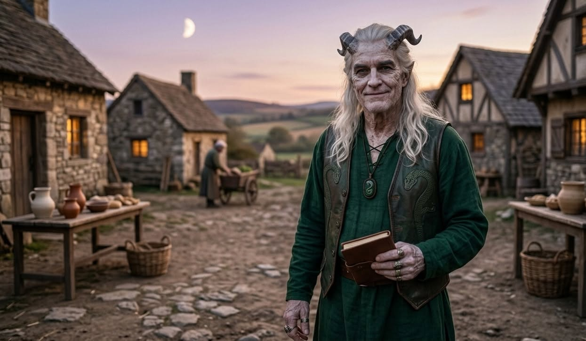
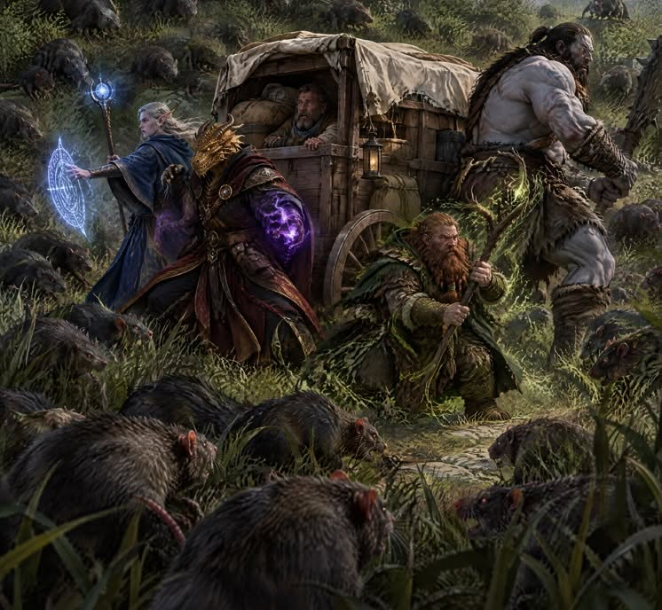
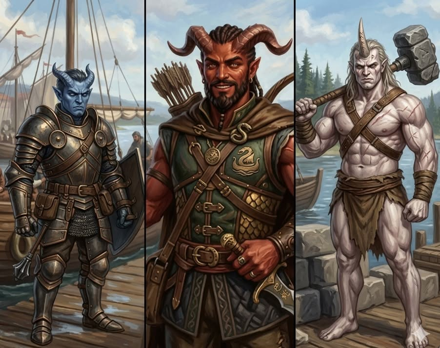

# Mission: R0045GS  

Mission R0045GS-請君入夢  
DM：草皮  
Level：2-3  
人數：4-7  
日期：2026年10月18日 (星期日)  
時間：14:00 - 18:00  
Start Game Time & Place : 神恩歷DG 1444年夏，泰晤士村  
End Game Time & Place: 神恩歷DG 1444年夏，泰晤士村  

## 玩家

- 44: High Elf Sage Wiz3(abjurer) M NG, 埃拉里安.薩拉諾.織星者  
- HM: Brass Dragonborn Noble Ftr2/Wlc1 M NG, 法夫尼爾·奧林  
- Peter: Human Sage Clr3(War) M NG, 康斯坦丁．李維斯 Constantine Reeves  
- 子平: Wood Elf Clr3 M CG, 洛克奧  
- King: Dwarf Sage Drd3(Sea) M TN, Ga Aa Ara 加 亞雅 阿羅  
- Sonia: Goliath (Hill) Soldier Bbn3(World Tree) F CG, Uma Shogg 烏瑪．修格  
- Tim: Human Brd2 F TN, 依文潔琳  

## 任務記錄

冒險者偶爾來到 “卡利伯努斯 領” 的 “泰晤士村 (Times Village)”, 早上, 在村中心磨坊的位置, 有行腳商人 麻斯特(Must) 招請護衛南行, 麻斯特 是一名白色皮膚的提夫林(Chthonic Tiefling), 冒險者受聘, 簡單預備, 起行. 其中男性矮人 加亞雅阿羅 感覺到 麻斯特 特別對他有興趣.  

一行人圍繞著 麻斯特 的雙輪單軸車(Cart), 在高過膝蓋的長草叢中行進, 下午接近黃昏時, 草叢中有大鼠襲擊, 一眾冒險者把大鼠消滅. 之後在入黑前, 一行人行到一個小聚落(Hamlet)休息, 小聚落中的一名中年人類 谷。列治文(Grian Richmond) 招待 麻斯特 等人到空置的大穀倉, 似乎 麻斯特 平日經常往來這兒.  

是夜, 除了兩名精靈外, 數名冒險者都發了同一個夢, 夢見一隊六人, 有一名潛行者先潛入山洞, 偵測洞中的眼魔, 佈下陷阱, 然後一名滿身孢子的傢伙放出毒霧, 漫延入山洞, 另一名持有聖徵的詩人鼓舞士氣, 鼓舞期間, 後面的三人中有二人行前, 爆開衣服, 左面的變身成一名狼人, 右面的變身成一名雪怪(Abominable Yeti), 二人衝入山洞, 攻擊眼魔, 最後一人揚手, 有多只行走喪屍及飛行喪屍進入山洞協同攻擊; 他們全部一起攻擊眼魔, 期間, 雪怪跳起,騎到眼魔頭上, 跟著被石化, 但石化了的雪怪, 重量極重, 把眼魔硬生生壓在地上, 於是眼魔被一行硬生生撕成碎片, 死亡.  

畫面完結之時, 有七言絕句出現:

> 獨目雖終夢未央，  
> 紫煙化髓入膏肓。  
> 萬類枯榮皆幻眼，  
> 林深林外盡瘋狂。  

翌日, 發夢的冒險者醒來時都有一點點不適, 其中 加亞雅阿羅 感知豁免失敗, 長休並沒有正常的恢復. 一行發夢的冒險者發現大家都發了同一個夢, 原因暫時不明.  

這一天行至入黑時, 終於到了 麻斯特 口中的tiefling村, 渡頭 “無憂渡”. 麻斯特 帶著一行人去到一間旅館前, 旅館招牌用歪歪斜斜的Common寫著 “油炸狗肉”, 下面似乎有塗改的痕跡.  

旅館老闆, 一名紅色皮膚的男性煉獄提夫林(Infernal Tiefling)主動出來和 麻斯特 打招呼, 麻斯特 稱呼旅館老闆為 巴蛇 (Ba Sir), 並且帶著一行冒險者進入旅館食晚餐.  

旅館由 巴蛇 和他的提夫林祖母, 提夫林父母, 提夫林兒子一同打理; 巴蛇 介紹, 基本晚餐是 慢燉鹿肉, 但是日推介是 “阿斯莫血腸 (Aasimar Blood Sausage) 配酸菜”, 另外兩款推介分別是 “煙燻鮭人 配 酸奶香草 (Smoked Ryan with Fiery Dill)” (重口味之選), 和 “風乾野牛牛肉 與 燻起司 (Dried Barbarian Jerky & Smoked Gouda)”, 烏瑪 品嚐 阿斯莫血腸, 辨別出不是aasimar, 只是豬血, 洞察出在這渡頭, aasimar被視為污穢不堪低賤如豬.  
飲品以顏色極黑、帶有強烈的煙燻泥煤味的 冥河黑啤酒 (Styx Stout) 為主, 但 法夫尼爾 品酒要求比較高, 寧願掏腰包自費, 點了一杯 “迪斯帕特 精釀烈酒 (Dispater’s Aquavit)”, 是一杯杯中燃起微弱的藍色火焰的阿夸維特(即伏特加), 這款烈酒傳說是由 九層地獄(Nine Hells)第二層的領主 迪斯帕特 流傳出來的.  

晚飯後, 康斯坦丁 特別留意到有似乎是教堂的建築, 發現有Asmodeus的聖徵, 但不對外開放; 冒險者和路過的村民談話, 得知 無憂渡 有接近一百人, 九成以上都是提夫林, 只有一部份是娶回來的外族; 無憂渡 有五個家庭, 他們身處的北岸, 北岸靠西有 巴蛇 的安家, 北岸中間的信心家, 信心家是藍色皮膚的深淵提夫林(Abyssal Tiefling), 家主 復仇。信心(Venge Faith) 有四名兒子, 一直致力把他們都訓練成噴毒霧的Asmodeus的聖騎士; 北岸靠東的是樸文家, 同樣是藍色皮膚的深淵提夫林, 他們一家信的是Corellon Larethian, 家主 滿月(Full Moon) 是神官.  

南岸兩家都是白色皮膚的冥界提夫林(Chthonic Tiefling), 南岸靠西是尾巴家, 全個渡頭的工坊、磨坊、打鐵、烤爐都在他們家. 南岸靠東是春家, 春家的都是術士巫師; 埃拉里安 特地渡河到南岸, 發現尾巴家有疑似女性精靈出沒, 但她非常傲驕, 不願意交談; 反而尾巴家的家主老婆 金嬸(七十多歲提夫林) 和 她的媳婦 晶姐(四十多歲提夫林) 很喜歡說話和吵架, 她們拉著 埃拉里安 說了好一會話, 原來 晶姐 的兒子娶了一個精靈, 而那精靈的妹妹又搬了來, 就是那位傲驕的精靈.  

是夜, 冒險者在 無憂渡 內休息, Asmodeus保佑, 沒有人發夢.  

翌日, 信心家的 雨嬸 來找 巴蛇, 原來她的第四子 標準。信心(Standard Faith) 昨晚溜了去西面森林, 想找人找回他, 巴蛇 推薦她找冒險者幫忙, 雨嬸 願意付酬, 成事.  

冒險者跟著 標準 的足跡, 一路進入森林, 行至下午, 遇到一棕熊, 撃退棕熊, 洛克奧 以身為餌, 消滅了潛藏的藤蔓怪和樹枝怪; 當行至天黑時, 冒險者決定多行一會, 半小時後, 聽到前面樹後有哭聲, 同時, 發現有兩只全新的棕熊和一只梟熊; 冒險者迎戰, 期間, 埃拉里安 使用迷霧步, 閃到前方, 發現哭聲來自一只碎嘴獸(Gibbering Mouther), 碎嘴獸以其胡言亂語特性模仿了一種詭異地像一個痛苦的嬰兒的哭聲, 同時, 埃拉里安發現碎嘴獸身後躺著昏迷的 標準.  

埃拉里安 行到碎嘴獸可以接近的位置, 引誘碎嘴獸及其中一只棕熊先後攻擊他, 捨身成仁(伏地而己); 冒險者合力, 快速撃殺棕熊和梟熊, 然後使用多方技能把碎嘴獸減速, 令碎嘴獸無法前進或後退, 最終把碎嘴獸撃殺.  

冒險者救回 標準, 然後找地方好好休息, 先短休, 後長休.  

長休至快要天光時, 有一名Halfling出現, 在 法夫尼爾 詢問時, 他行前說話; 他自稱 小皮平 (Little Pip Pin), 是一名十五歲的輕足半身人, 志願是成為一名詩人, 可以去嘲諷大猩猩; 他喜歡跟冒險者說話, 因為按他說, 他是與 “叔叔”, “大姐姐”, “大大姐姐” 一起在森林中生活; 叔叔似乎是一名啞巴矮人, 大姐姐似乎是二十多歲女性人類武僧, 大大姐姐似乎是四十多歲女性人類德魯依(會變身的), 大姐姐和大大姐姐說他們在森林是守護一個曾經是城堡的地方; 談到 無憂渡, 他知道 無憂渡 就是 Demon Hunter's Crossing, 傳聞很久很久以前, 那些tiefling是站在魔鬼(devil)一方, 專門攻擊獵殺惡魔(demon)的.  

說話完畢, 康斯坦丁knows (滿足傳訊術條件) 後, 小皮平 自行離開, 冒險者把 標準 帶回 無憂渡; 康斯坦丁 knows了相關人士, 冒險者按原定, 保護 麻斯特 向北回轉.

行一日, 同樣在列治文家的大穀倉休息, 翌日, 起來, 回 泰晤士村 的路上, 突然出現一只尤格羅斯惡魔, 攻擊他們; 麻斯特 先被撃倒, 洛克奧 救回 麻斯特, 並且站前保護他; 旋即, 洛克奧 被撃倒, 原地消失? 其他冒險者奮戰, 持續對尤格羅斯構成傷害; 忽然大家無法動作, 尤格羅斯好像被從中撕開, 裡面出來一只死靈眼魔! 死靈眼魔望了望眾冒險者, 喃喃道, “不是這幾個…” 然後大家忽然醒了.  

原來眾冒險者, 包括精靈, 都被拖入夢境之中, 洛克奧 在夢中版撃殺, 醒來時帶著一個Exhaustion level. (因無後績, 洛克奧 之後長休便可以回復)

死靈眼魔名為 弗雷敵。黑魯格 (Freddi Heruge), 是一只異怪(惡魔, 亡靈), 剛剛好死了七七四十九天, 現在正在四處尋仇中. 但其實他不是男Tiefling法師, 那只是傳聞, 他其實只是五百年前男Tiefling法師的第八代徒弟而已. 他要復仇, 目標應該是撃殺他原有肉身的六人眾…

其他軼事:

- 麻斯特 (Must) 只走南北, 但南只至 無憂渡, 因為 無憂渡 以南兩日路程的女神村嚴重地仇視提夫林, 尤其是男性提夫林  
- 走東西的行腳商是另一位, 但未有提及  
- 無憂渡 (Demon Hunter's Crossing) 像一個冒險職業訓練中心多於像一條村, 但他們對於森林野獸等不大在意  
- 小皮平 等四人守護那個曾經是城堡的地方, 是五百年前公爵A的地方  
- 撃殺眼魔 弗雷敵 的六人眾不在附近附子, 也不在森林, 同時, 相信他們中間有人懂得魔法傳送  

## 人物表  

### 卡利伯努斯領人物  

泰晤士村是一個人口數百人的小村落，隸屬卡利伯努斯領。  

---

～Ends～

[Back to Missions List](../Missions.md)  
[Back to Front Page](../../../../index.md)  
