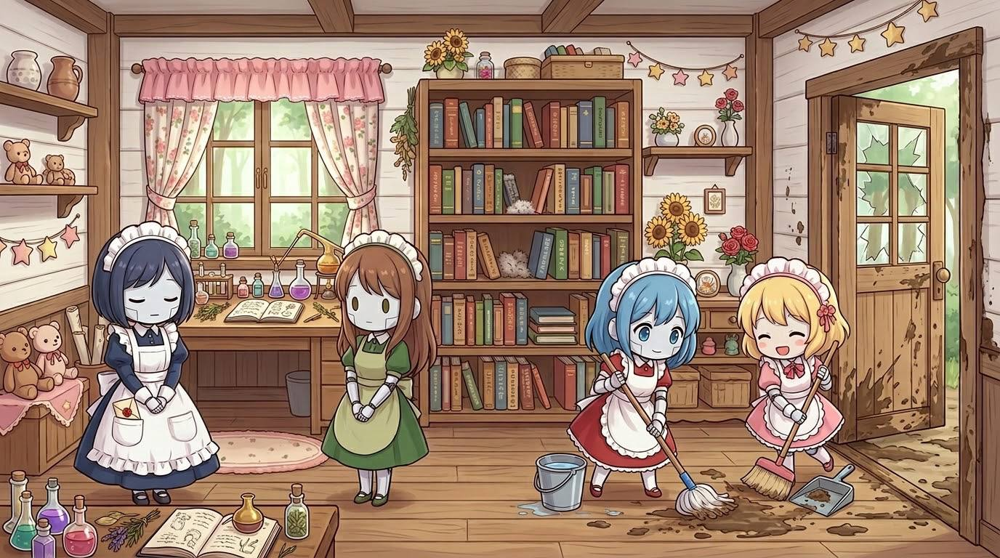
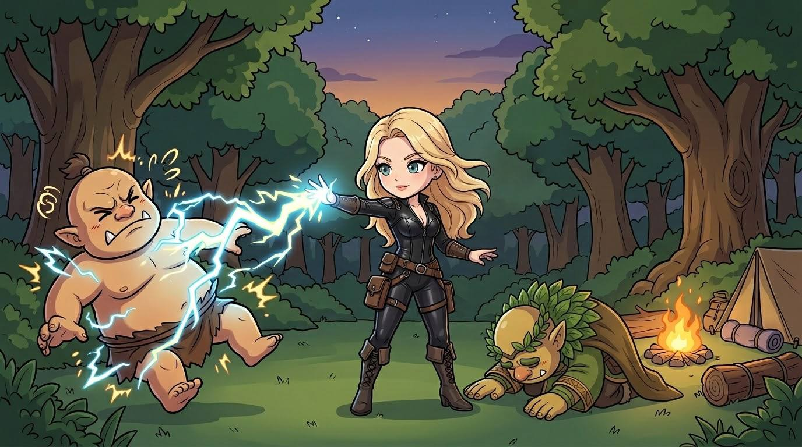

# Mission: R0044H  

Mission R0044H-零氏物語 ~ 一之四 執迷的死者  
DM：H  
Level：3-4  
人數：4-6  
日期：2026年10月11日 (星期日)  
時間：14:00 - 18:00  
Start Game Time & Place : 神恩曆1444年夏季，[森普斯鎮](../../backgrounds/location/SimpleTown.md)  
End Game Time & Place: 神恩曆1444年夏季，[森普斯鎮](../../backgrounds/location/SimpleTown.md)  

## 玩家

- Timmy: Wood Elf Scribe Wiz3(Bladesinger) F, [Kaelia Liadon 凱莉雅．銀葉 (K)](../../characters/Character_Kaelia.md)  
- 44: Aasimar Hermit Clr3(Life) M, 基爾．希默  
- Mark: Human Merchant Ftr3(EK) M, 維吉爾 Vigil  
- JM: Elf Sage Drd3 F, 艾琳娜 Elena Starweave  
- Tim: Dwarf Farmer Clr1/Wiz2 M, 艾爾登  
- HM: Human Acolyte Wlc3 F, Forsythia Jaune 科茜賽亞·尊  

## 任務  

森普斯鎮北面的一個名叫赤林村的地方，早前有人遇見幽靈出沒在樹林之中。  
因而出現了調查的委託。  
在小鎮中冒險者經常聚集的小酒吧 ~ 藍圖旅館  
一則消息傳來，早前 “賣燒賣的老婆婆” 近一周也沒有出現了。  

## 任務記錄

承上回 [討伐Green Hag三姐妹的二姐Iliane](./R0038H.md) 後，再次聽聞大姐居所的赤林村鬧鬼，於是市政廳再次發出任務。眾人在市政廳聽學者尼高簡報近況：一、大姐Irene的伴侶鬼魂約翰(John)演變成赤林村鬧鬼事件；二、燒賣婆婆三嬸Ivy於一週前失蹤。尼高認為兩者可能有關連，聘請冒險者查明真相。  

冒險者考慮Hag姐妹之間其中一人被伐，可能會影響另外二人，所以決定由近而遠到每個關係地點查看。先到三嬸沼澤住所、二姐討伐現場、赤林村、哥布林村、最後到達大姐沼澤住所探訪。  

一行人到達鎮西北森林沼澤的三嬸住所，停泊的騾車失蹤而糖果屋和湖中屋皆已上鎖。希默擔心三嬸安危破門進入湖中小屋，發現屋中只有4位女僕外表的機械人(Homunculus)。希默帶進屋的沼澤泥濘，觸發眾女僕打掃工作。眾人發現女僕們只管清潔，就在清理腳下後進屋查探。其中書櫃上有大量書籍，當中死靈魔法研究就缺了兩三本。K也在其中一位女僕口袋中找到大姐寄來的書信，指需要三嬸的死靈書來處理二姐身後事。眾人了解內情後，收拾回原狀（除了破門）後離開小屋。  

離開時眾人發現騾車向北離開的車輪痕跡，與書信內容吻合，故跟隨追查。2天後輪痕到達赤林村附近，確認鬧鬼詳情和約一週前騾車經過，眾人便前往大姐住處。  

森林中遇見鬼魂約翰，指大姐失蹤多日因而四出尋找，眾人到達住處木屋，想入內查探被約翰阻止。眾人在木屋外發現騾車來到並轉往西南離開，繼續追跡2小時後，發現騾車在離開森林時被食人魔(Ogre)襲擊，騾車全毁並拖走獵物。眾人追蹤Ogre足跡上山，入黑時到達哨站營地並擊敗3隻Ogre。戰後短休時再遇3隻Oger回來圖重奪哨站，途中大姐加入戰鬥並徒手迫降最後1隻Ogre德魯伊。  

大姐講述與三嬸前往處理二姐後事時，在騾車上受襲，三嬸因騾子遇害而憤而離去，大姐則隨Ogre回部族了解其襲擊意圖。及後清滅Ogre巢穴離開時，就遇上方才的戰鬥。眾人提醒大姐約翰鬧鬼之事，大姐驚覺花耗太久，拜托眾人安撫約翰後，便迫Ogre德魯伊化身為坐騎，向二姐討伐現場徉長而去。  

眾人收拾好哨站後過夜，次日上山到達山洞巢穴，洞穴原為藏寶洞，後被信奉五色龍神(Tiamat)的Ogre族佔領，裡面數十Ogre不論男女老幼全數被殲，眾人便處理眾多遺體後回程找約翰。在大姐木屋遇到尼高和約翰，滙報情況後尼高認為邪教問題茲事體大，故趕回鎮上回報，而眾人則去哥布林村落查問二姐討伐現場的情況。  

眾人到達哥布林村，驚聞哥布林竟然已把二姐遺體吃掉，還把骨頭做成骨器。希默警示大姐正趕來追討遺體，嚇壞眾哥布林，K遂建議哥布林們收拾細軟外逃。族長在收集所有骨器，安葬在村外並立下哥布林文字的墓銘後，便率全村逃難。而眾人則回到三嬸沼澤，向已經回來的三嬸賠罪並賠償破門損失，然後回市政廳覆命。  

## 人物表  

### 森普斯鎮人物  

[森普斯鎮](../../backgrounds/location/SimpleTown.md) 位於大陸南端，獵戶河西面支流的海岸河口之處。  

- **學者** : 尼高 (Nico) ～ 中年男性人類。隱士，專研歷史及不死物。面色蒼白黑色外袍，慵懶。有一魔寵能幹貓。在森普斯鎮藍圖旅館長期租用一房。  
- **Green Hag三姐妹** : 綠鬼婆，三姐妹  
  - **大姐** : Irene ～ 三姐妹大姐。美女外貌，愛男人。住在赤林村西北森林中，以魔法幻境驅走外人干擾。  
  - **二姐** : Iliane ～ 三姐妹二姐。憤世嫉俗，因為 [誘拐󠄆兒童](./R0037H.md) 罪名，在 「[忘亡忙妄](./R0038H.md)」 中由森普斯鎮市政廳發出任務下被參與者擊殺，地點位於赤林村與大姐住所森林之間。  
  - **三姐** : Ivy ～ 三姐妹三姐，人稱三嬸。老婆婆外貌，愛錢。住在森普斯鎮西北森林中的沼澤湖中小屋，晚上在森普斯鎮西北的學院外販賣燒賣。  

---

～Ends～

[Back to Missions List](../Missions.md)  
[Back to Front Page](../../../../index.md)  
